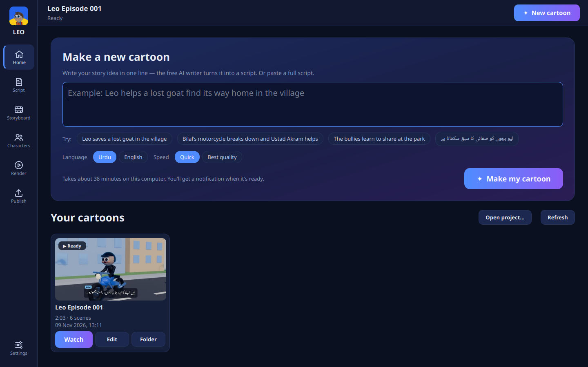

# Leo 3D AI Cartoon Studio

Local, free, offline-first desktop app that turns an Urdu or English cartoon script into a
3D animated MP4 (1280×720, 24 fps, H.264/AAC, at least 60 s).

**Story idea or script → Make my cartoon → watch, re-render scenes, publish to YouTube.**

Blender (background mode) does the 3D modelling, rigging, animation and rendering. Python does
script analysis, directing, speech, lip-sync data, sound, subtitles and FFmpeg assembly. No paid
APIs, no API keys, no cloud rendering.

---

## 1. What it does

| Stage | Implementation |
|---|---|
| Script parsing | `core/script_parser.py` — scene headings (`Scene 1:`, `سین 1`, `INT./EXT.`), `Visual:`, `Narrator:`/`راوی`, `Name (emotion):` dialogue, `[SFX: …]`, `Camera:`, `Transition:`. Infers scenes when there are no headings. Never rewrites dialogue. Unlabelled text is kept as visual description and reported. |
| Scene intelligence | `core/scene_manager.py` — location (10 environment types), characters present, per-character actions (subject-before-verb rule), dialogue emotion, camera hints, sound effects, duration estimate. English + Urdu keywords. |
| Character registry | `core/character_manager.py` + `assets/characters/presets.json` — Leo, Karim, Bilal, Ustad Akram, Boss, Chintu, Motu, Narrator are hand-designed; any other name gets a deterministic design from its name + script context (girl, police, old…). Saved to `registry.json`; each design is built once to `assets/characters/<id>.blend` and reused while its design hash is unchanged. |
| 3D characters | `blender/character_builder.py` + `blender/base_body.py` — body from the CC0 Quaternius *Universal Base Characters* (male/female, vendored in `assets/characters/base/quaternius_ubc/`), re-proportioned per character by bone scaling (child limbs, build width, belly), posed into A-pose, subdivided, re-skinned to our rig and painted with the costume by body region. Its realistic head is replaced by a stylised cartoon head: big two-tone eyes with catch-lights and eyelashes, eyelids, thick brows, cheeks, nose, ears, hair styles, mouth. Accessories: helmets, reflective vest, jacket, cape, golden L emblem, agent badge, belt, wrench, embroidered waistcoat, boots / sneakers / sandals. Inverted-hull toon outline. Falls back to a metaball body if the base files are missing. |
| Rigging | `blender/rig_builder.py` — shared humanoid template placed on the base body's joints: root, hips, spine, chest, neck, head, jaw, brows, shoulders/arms/hands, legs/feet, prop bone, cape chain; 2-bone leg IK with foot IK controls and foot rotation constraints. |
| Environments | `blender/environment_builder.py` — construction site, city road, motorcycle garage, car workshop, house, school, police station, park, villain hideout, shop, village (mud-brick houses, charpai, clay pots, haystack): ground, buildings, props (crane, bricks, scaffold, cars, motorcycle, lift, tool racks, tyres, trees, benches, swings…), gradient sky dome, clouds, sun + fill light. |
| Animation | `blender/motion_library.py` + `blender/animation_builder.py` — reusable clips (idle/breathing, walk & run with planted feet, fly, hero landing, jump, sit, ride, celebrate, laugh, scared; gestures talk, point, wave, clap, threaten, hands-on-hips, work, look-around, power-up, surprised). Layered evaluation with cross-fade blending, gesture masking, head look-at toward the speaker, then per-frame keyframes. |
| Facial animation | Shape keys Blink, Open, Wide, Round, Smile, Frown + jaw and brow bones; expression presets per emotion; random natural blinking. |
| Cinematography | `core/timeline_manager.py` (shot planner) + `blender/camera_builder.py` — establishing, wide, medium, close-up, extreme close-up, over-the-shoulder, tracking/follow, low-angle hero shot, dolly in/out, orbit; eased moves inside shots, cuts between shots, timeline markers per shot. |
| Urdu TTS | `engines/voice_engine.py` — Meta MMS-TTS (local VITS) → eSpeak NG fallback → manual WAV import. Per-character pitch/tempo profiles. Cached. |
| Lip-sync | `engines/lipsync_engine.py` — per-frame loudness → mouth open/jaw; spectral centroid → wide vs round shapes. Only the speaker's mouth moves. |
| Sound | `engines/sound_engine.py` — original procedural SFX (footsteps, flying, landing, hero sting, magic, shield, motorcycle, car, siren, crowd, transitions), per-location ambience, original procedural music; dialogue-priority ducking, fades, soft limiter, stereo. |
| Subtitles | `engines/subtitle_engine.py` — SRT from the original text; burned-in PNGs shaped with HarfBuzz/FriBiDi (Pillow + libraqm) in Noto Nastaliq Urdu, right-to-left. |
| Look | Warm low key sun + cool sky fill + back rim light, AgX "Punchy" tone mapping, ambient occlusion, per-shot depth of field (wide f/8–11, close-up f/2). |
| Rendering | `blender/render_manager.py` — Blender EEVEE (Workbench fallback if no GPU context; Cycles optional), frame-by-frame JPEGs with resume. |
| Assembly | `engines/video_assembler.py` — FFmpeg: per-scene clips, cross-dissolve / fade-through-black (`xfade`), subtitle overlays, AAC audio. |
| Verification | `utils/validators.py` — ffprobe (or ffmpeg fallback) streams, codecs, 1280×720, 24 fps, ≥ 60 s, A/V duration match, frame count, full decode check, OpenCV scan for missing/blank/corrupt frames, all scenes and all dialogue lines accounted. |

## 2. Installation (Windows 10/11 and Linux)

The studio runs on **Windows 10/11 (x64)** and **Linux (Ubuntu 24.04 tested)**. Both installers set up
a Python virtual environment, install the pinned packages (FFmpeg comes with the `imageio-ffmpeg`
package, Urdu fonts are bundled in `assets/fonts/`), download the portable Blender 4.5 LTS from
blender.org with SHA-256 verification if Blender is not already installed, and finish with a system check.

### Windows

1. Install Python 3.11 or 3.12 from python.org (tick *Add python.exe to PATH*; keep *tcl/tk*).
2. In the project folder, run in PowerShell:

```powershell
powershell -ExecutionPolicy Bypass -File install_windows.ps1
```

3. Start the studio by double-clicking `run_windows.bat`.

EEVEE renders on the GPU through the graphics driver (Intel, AMD or NVIDIA); keep the driver updated.
On Windows, Pillow normally has no FriBiDi, so Urdu subtitles are shaped with `arabic-reshaper` +
`python-bidi` and drawn in Noto Naskh Arabic (joined, right-to-left; Naskh instead of Nastaliq style).

### Linux

```bash
bash install_linux.sh
```

```bash
./run_linux.sh
```

Optional system packages for the best result (Nastaliq subtitles via libraqm, system FFmpeg with ffprobe):

```bash
sudo apt install python3-tk ffmpeg libraqm0 fonts-noto-core
```

With the system `python3-tk` the window uses anti-aliased fonts. A uv-managed Python (used by the
installer when the system Python lacks Tk) works too, but its Tk has no Xft: the window uses bitmap fonts
and the edit box cannot shape Urdu. The **Urdu preview** tab and the video subtitles are unaffected.

### Manual setup (any OS)

```bash
python -m venv .venv
.venv/bin/pip install -r requirements.txt --extra-index-url https://download.pytorch.org/whl/cpu
```

On Windows use `.venv\Scripts\pip`. Then install Blender 4.5 LTS anywhere and, if it is not found
automatically, set `LEO_BLENDER` to `blender` / `blender.exe`. Searched automatically: PATH,
`tools/blender-4.*`, `~/opt/blender-4.*`, `C:\Program Files\Blender Foundation\Blender 4.*`.

### Optional model download

The Urdu MMS-TTS voice (`facebook/mms-tts-urd-script_arabic`, about 145 MB) and the English one
(`facebook/mms-tts-eng`, about 145 MB) download from Hugging Face the first time a script is
generated with the voice engine set to `auto` or `mms` (verified working on the development machine). They are stored in `models/cache/hf/` and
used offline afterwards. Without them (offline, or download blocked) the app uses eSpeak NG and says
so in the log and `project.json`. Nothing else is downloaded.

### Optional: AI video mode (Pixar-like look on an NVIDIA GPU PC)

Instead of rendering in Blender, the studio can send every shot to a free **ComfyUI** server
(Flux.1-schnell restyle → Wan 2.2 image-to-video → LatentSync lip-sync). It keeps the studio's
characters, staging, voices, subtitles and timing. Needs an NVIDIA GPU with 12–24 GB; see
[assets/comfy_workflows/README.md](assets/comfy_workflows/README.md) for setup, speed and licences.

### The studio window



A dark, video-editor style window (Qt 6 / PySide6, same on Windows and Linux). The sidebar has seven
pages; `Ctrl+1` … `Ctrl+7` jump between them.

| Page | What you do there |
|---|---|
| **Home** | Type a one-line story idea (or paste a script), pick **Urdu/English** and **Quick/Best quality**, press **Make my cartoon**. Below: all your cartoons with a picture, length and date; **Watch**, **Continue** (finish an unfinished one), **Edit**, **Folder**. |
| **Script** | Editor with colours for scene titles, `Visual:` lines and speaker names; Urdu lines run right-to-left. The side panel checks the script while you type (scenes, lines, length, characters, warnings). **AI write from idea…**, **Leo sample**, **Open…**, **Save project…**, **Make cartoon from this script**. When an episode is open, making it again reuses every unchanged scene and renders only the changed ones. |
| **Storyboard** | Built-in video player with scene markers; one card per scene (picture, place, length, characters). Click a card to jump there. **↻ Re-render** renders only that scene again (for example after changing a character) and rebuilds the video. |
| **Characters** | The cast as cards with their 3D preview. Change skin, hair, eye and clothes colours, height, build and belly; use your own rigged 3D model (`.glb .gltf .fbx .blend`, Mixamo or Unreal/Quaternius bone names) with or without its own head. Only the edited character is rebuilt on the next cartoon. |
| **Render** | Step tracker for the 12 stages, progress, time left, the newest rendered frame as a live preview, activity log, **Stop** (frames are kept; **Continue** resumes). A desktop notification appears when the video is ready. |
| **Publish** | Title, description and tags drafted from the script; thumbnail maker (pick a frame, big Urdu or English title, colour, position; 1280×720 JPEG); upload to your own YouTube channel — **Private** by default, *made for kids* and *AI-generated content* flags set. |
| **Settings** | Quality, output folder, music, AI backgrounds, voice engine, your own recordings, render engine (this PC or a ComfyUI GPU server), free AI tool downloads, hardware report. |

The first time you make a cartoon from an idea, the app offers two free AI tools that run on the CPU
(no graphics card, no internet afterwards):

| Tool | What it does | Download | Licence |
|---|---|---|---|
| AI story writer: llama.cpp + Qwen3-4B-Instruct-2507 (Q4) | writes the script from your idea, checked by the studio's parser and corrected automatically; you review it before rendering | ≈ 2.5 GB | MIT + Apache-2.0 |
| AI background painter: OpenVINO + LCM-Dreamshaper-v7 int8 | paints a background for each place, reused by every episode; needs about 4 GB of free memory while painting (skipped automatically when there is less) | ≈ 2.3 GB | Apache-2.0 + model card MIT (SD 1.5 base: CreativeML OpenRAIL-M) |

Both are optional: without them, paste scripts yourself and the procedural 3D backgrounds are used.

**YouTube upload, one-time setup (free):** in [Google Cloud Console](https://console.cloud.google.com/)
create a project, enable *YouTube Data API v3*, set up the OAuth consent screen (External, add your
e-mail as a test user), create an OAuth client of type **Desktop app** and download its JSON. In
**Publish** press **Choose client file…**, then **Sign in** (your browser opens). The sign-in token is
stored in `tokens/youtube.json` — keep that folder private. The free quota allows about six uploads a day.

The older, simpler window is still available: `python main.py --classic`. On Linux/X11 the Qt window
needs the system library `libxcb-cursor0` (`sudo apt install libxcb-cursor0`); without it the classic
window opens automatically.

## 3. Running

```bash
.venv/bin/python main.py                 # studio window  (Windows: run_windows.bat or .venv\Scripts\python main.py)
.venv/bin/python main.py --classic       # older, simpler window
.venv/bin/python main.py --check         # hardware, Blender, FFmpeg, model status
.venv/bin/python main.py --cli assets/scripts/leo_episode_001.txt --quality standard --out output
.venv/bin/python main.py --idea "Leo saves a lost goat" --lang ur --quality preview
```

Manual audio: put `s01_e003.wav` (scene 1, event 3 — see `parsed_script.json`) or `001.wav`
(line number) files in a folder and select it in **Settings → My recordings**; those recordings
replace synthesized speech.

Projects: **Save project** writes the script and settings to `projects/<name>.leo.json`; **Open…**
loads a project or a plain `.txt` script. Every generation also saves its project file automatically.
Re-generating an episode reuses rendered frames only for scenes that are exactly unchanged (a
signature of the scene, quality and character assets is stored next to the frames). Character edits
are saved to `assets/characters/registry.json`.

### Output layout

```
output/leo_episode_001/
  final_cartoon.mp4  subtitles.srt  project.json  scene_data.json  characters.json  parsed_script.json
  characters/  leo.blend karim.blend bilal.blend ustad_akram.blend boss.blend chintu.blend motu.blend + *_reference.png
  scenes/      scene_001.blend … scene_006.blend
  audio/       dialogue/  narration/  music/  sound_effects/  master_mix.wav
  renders/     scene_001/frame_0000.jpg …
  logs/        generation.log, blender_*.log, render_*.log
  temp/        (emptied after a successful run)
```

Character assets are also kept in `assets/characters/` and reused by future episodes.

## 4. Tests

```bash
.venv/bin/python -m pytest -q tests                      # 43 tests (~4.5 min, Blender tests included; e2e is opt-in)
LEO_E2E=1 LEO_E2E_QUALITY=preview .venv/bin/python -m pytest tests/test_e2e.py -s   # full Leo episode
```

See [TEST_REPORT.md](TEST_REPORT.md) for the latest results.

## 5. Hardware, models, licenses, limitations

See [REPORT.md](REPORT.md): hardware compatibility, measured render speed, model and asset
licenses, and known limitations.
